<a href="https://zaidanikram.id">
  
</a>

<p align="center">
  <a href="https://zaidanikram.id"></a>
</p>

<p align="center">
  <a href="https://zaidanikram.id"></a>
  
  
</p>

<br />

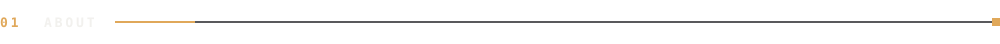

```ts
const kai = {
  name:      "Zaidan Ikram",
  role:      "Full-stack engineer · technical partner",
  base:      "Jakarta, Indonesia · UTC+7",
  study:     "Computer Science @ BINUS University (2024 → 2028)",
  shipping:  ["PassingLab", "HakaiKOL", "HakaiTask", "HakaiMusic", "KaiCash"],
  focus:     ["system design", "auth & RLS",
              "payments", "offline-first sync"],
  building:  "since 2022",
  openTo:    "full-time · 1 year · starting 2027",
  replyTime: "< 24h",
};
```


<a href="https://github.com/Fundchainbinus/fundchain">
  
</a>

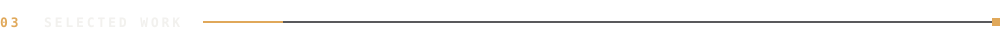

<p align="center">
  <a href="https://passinglab.id"></a>
  <a href="https://hakaikol.vercel.app"></a>
  <a href="https://hakaitask.my.id"></a>
  <a href="https://github.com/k41ts/hakaimusic"></a>
  <a href="https://github.com/k41ts/kaicash"></a>
  <a href="https://collatera-app.vercel.app"></a>
  <a href="https://flescrow.vercel.app"></a>
  <a href="https://github.com/k41ts/shiki"></a>
</p>

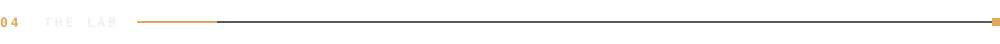

| Experiment | What it is | Stack |
| :-- | :-- | :-- |
| [**Pokerizz**](https://github.com/k41ts/pokerizz) | Kartu Duel: online PvP poker-hand card game, combos drain the opponent's HP | `TypeScript` |
| [**KaiLocate**](https://github.com/k41ts/kailocate) | Real-time location sharing app with Google Maps | `React Native` `Expo` `Firebase` |
| [**Hypercar Garage**](https://github.com/k41ts/hypercar-garage) | Cinematic 3D showcase: SF90 XX, Revuelto, Senna | `Three.js` `Vite` |
| [**ClaudeLimitWatch**](https://github.com/k41ts/claudelimitwatch) | Monitors and tracks Claude usage limits | `Python` |
| [**KaiAlpha**](https://github.com/k41ts/kaialpha) | Personal stock analyst: news, fundamentals, charts | `React` `Vite` `Recharts` |
| [**EduQuest**](https://github.com/k41ts/EduQuest) | Adaptive, gamified learning platform | `React` `Vite` `Firebase` |
| [**Agrichain**](https://github.com/k41ts/agrichain) | Agriculture prototype on a blockchain | `HTML` `JavaScript` |


<p align="center">
  <sub><code>LANGUAGES</code></sub><br />
  
</p>
<p align="center">
  <sub><code>INTERFACE · MOBILE</code></sub><br />
  
</p>
<p align="center">
  <sub><code>BACKEND · DATA</code></sub><br />
  
</p>
<p align="center">
  <sub><code>SHIP · OPERATE</code></sub><br />
  
</p>


<p align="center">
  
</p>

<p align="center">
  
</p>


<p align="center">
  <a href="https://zaidanikram.id"></a>
  <a href="https://www.linkedin.com/in/zaidanikram/"></a>
  <a href="mailto:276kai@gmail.com"></a>
  <a href="https://www.instagram.com/kai6v/"></a>
</p>

<p align="center"><sub><code>// END OF TRANSMISSION · replies within 24h</code></sub></p>
